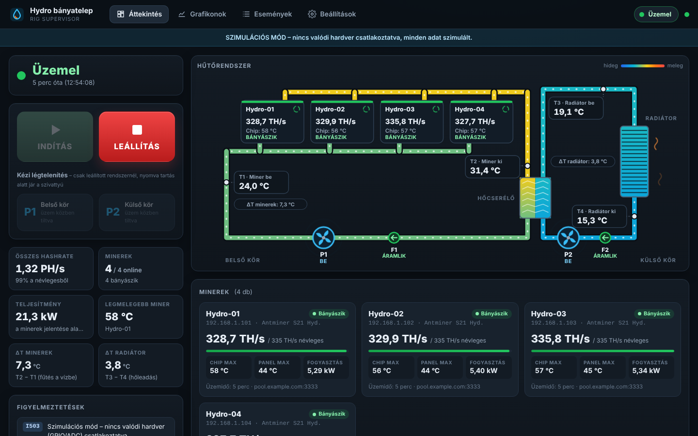
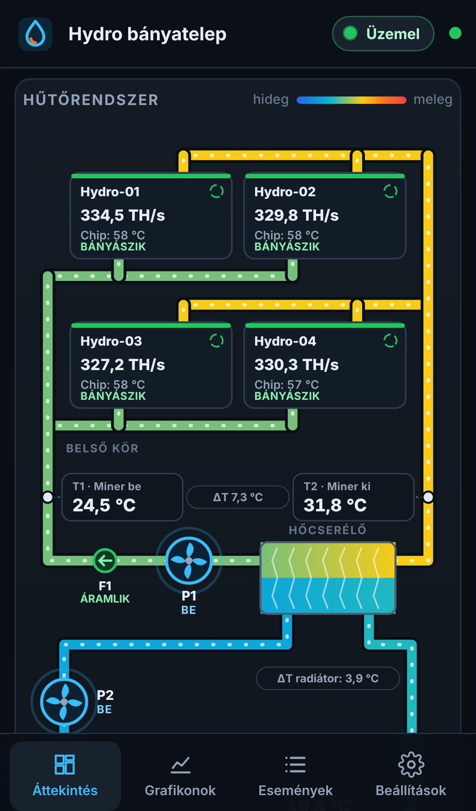

# Rig Supervisor – vízhűtéses Antminer bányatelep felügyelete Raspberry Pi-n

A program a Raspberry Pi-n fut, és egy webes felületen (telefonon és számítógépen is) mutatja és vezérli
a két vízkörös hűtőrendszert és a minereket:

- **Rendszerábra**: a minerek (dinamikusan, ahány van, annyi), a belső kör, a hőcserélő, a külső kör és a radiátor.
  A csövek színe a mért vízhőmérséklettől függ, a víz áramlása és a szivattyúk lapátja animált, ha járnak.
  A 4 vízhőmérséklet, az áramláskapcsolók és a minerek adatai (hashrate, hőfok, állapot) a megfelelő helyen láthatók.
- **4 gomb a főoldalon**: nagy **INDÍTÁS** és **LEÁLLÍTÁS** gomb, valamint két **tartásos (P1 / P2) gomb**
  a vízkörök kézi légtelenítéséhez – ezek csak leállított rendszernél működnek, és csak amíg nyomva tartod őket.
- **Fizikai START/STOP nyomógombok** ugyanazzal a funkcióval.
- **Biztonsági logika**: vészleállás hibakóddal, ha megáll (vagy el sem indul) a vízáramlás, ha egy figyelt
  hőmérő a beállított tartományon kívül kerül, opcionálisan szenzorhibánál; **utóhűtés**, ha leállítás után
  egy miner (vagy a víz) 60 °C fölé melegszik. A minerek saját hibái csak megjelennek – **nem állítják le a rendszert**.
- **Automatikus értesítések emailben és SMS-ben** (saját GSM modem, Twilio vagy tetszőleges HTTP SMS átjáró):
  KILLSWITCH, vészleállás és egyéb hibák, kézi indítás / leállítás, és ha egy miner **abbahagyja a termelést** – mindig hibakóddal.
- **Adatnaplózás** napi fájlokba; ha a naplók összmérete meghaladja a **10 GB**-ot (állítható), a legrégebbi
  napló törlődik. **Grafikonok** fül választható időtartománnyal (1 óra … 1 év, egyéni, nagyítás egérrel), CSV export.
- **Beállítások**: minerek hozzáadása (kézzel vagy hálózati kereséssel), védelmi határértékek és időzítések,
  **kalibráció** (élő feszültség/ellenállás/hőfok értékekkel), a szenzorok és SSR-ek **GPIO kiosztása** módosítható.
- Nincs szükség internetre és külső Python csomagokra – csak a Raspbianon elérhető GPIO/I²C/SPI könyvtárakra.





*(A képek szimulációs módban készültek.)*

---

## 1. Hardver – fontos tudnivalók

### 1.1 A hőmérők (10 kΩ NTC) mérése: ADC kell!

A Raspberry Pi-nek **nincs analóg bemenete**, ezért a termisztoros feszültségosztók feszültségét egy külső
**ADC** méri. Az alapbeállítás az **ADS1220** modul (24 bit, 4 csatorna, **SPI** – a modul lábkiosztása is
MISO/MOSI/SCLK/CS, tehát nem I²C-s, akármit ír a webshop leírása). Más ADC-k is választhatók
(ADS1115 I²C, MCP3008/MCP3208 SPI) a **Beállítások › Kalibráció & GPIO** oldalon.

| ADS1220 modul láb | Raspberry Pi | Megjegyzés |
|-------------------|--------------|------------|
| SCLK | GPIO11 (23. tű) | SPI0 órajel |
| MOSI (DIN) | GPIO10 (19. tű) | |
| MISO (DOUT) | GPIO9 (21. tű) | |
| CS | GPIO8 / CE0 (24. tű) | |
| DVDD | **3,3 V** (1. vagy 17. tű) | a logikai szint – a Pi nem 5 V-tűrő! |
| DGND, AGND | GND | |
| CLK | GND | belső órajel |
| DRDY | – | nem szükséges (a program időzítéssel olvas) |
| AVDD | **ugyanaz a táp, mint a termisztoros osztóké** (3,3 V vagy 5 V) | |
| AIN0 / AIN1 / AIN2 / AIN3 | T1 / T2 / T3 / T4 osztó közös pontja | |
| REFP0 / REFN0 | – | csak „külső referencia” módban |

A program a referenciát alapból az **AVDD**-re állítja (arányos mérés): mivel az osztó és az ADC ugyanarról a
tápról megy, a mérés eredménye nem függ a táp pontos értékétől, és a tápfeszültség ingadozása sem okoz hibát.
Így a mostani **5 V-os osztók is maradhatnak** – ekkor az AVDD-t is 5 V-ra kell kötni, a DVDD-t viszont
3,3 V-ra. (Ha az osztókat 3,3 V-ról táplálod, az AVDD is 3,3 V legyen.)

```
 AVDD-táp ──[ 10 kΩ fix ]──┬──────► ADS1220 AIN0 (T1) / AIN1 (T2) / AIN2 (T3) / AIN3 (T4)
 (3,3 V vagy 5 V)          │
                      [ NTC 10 kΩ ]
                           │
 GND ──────────────────────┴──────► ADS1220 AGND
```

Mérés: egyvégű (AINx–AGND), PGA kikapcsolva (rail-to-rail bemenet), 45 minta/s, csatornánként 5 minta
mediánja másodpercenként. Ellenőrzés a Pi-n: `ls /dev/spidev0.0` (ha nincs, engedélyezd az SPI-t:
`sudo raspi-config` › Interface Options › SPI – a telepítő ezt automatikusan megteszi).

A termisztor béta értékét (gyakran 3950 vagy 3435) a kalibrációs oldalon lehet megadni. A szenzor
szakadását, rövidzárát és az ADC kommunikációs hibát a program felismeri és jelzi.

### 1.2 Digitális be- és kimenetek – alapértelmezett kiosztás (BCM számozás)

| Funkció | GPIO | Fizikai tű | Aktív szint | Megjegyzés |
|---------|------|-----------|-------------|------------|
| P1 szivattyú SSR (belső kör) | GPIO17 | 11 | magas | |
| P2 szivattyú SSR (külső kör) | GPIO27 | 13 | magas | |
| F1 áramláskapcsoló (belső kör) | GPIO22 | 15 | alacsony | áramláskor alacsony jelet ad |
| F2 áramláskapcsoló (külső kör) | GPIO23 | 16 | alacsony | |
| INDÍTÓ nyomógomb | GPIO24 | 18 | alacsony | 10 kΩ felhúzás 3,3 V-ra, lenyomva 0 |
| LEÁLLÍTÓ nyomógomb | GPIO25 | 22 | alacsony | |
| **KILLSWITCH** | GPIO5 | 29 | **magas** | abszolút vészleállás, belső lehúzó ellenállással |

Minden láb és aktív szint a webes felületen módosítható (**Beállítások › Kalibráció & GPIO**), ahol egy
40 tűs csatlakozó ábra is mutatja a foglalt lábakat. A program ellenőrzi az ütközéseket (két funkció egy lábon,
az ADC busz lábai).

**Szoftveres negálás (aktív szint):** minden ki- és bemenetnél külön választható, hogy a „magas” vagy az
„alacsony” szint jelenti-e az aktív állapotot:
- kimenet (SSR): „Magas = aktív (normál)” → BE állapotban 3,3 V a lábon; „Alacsony = aktív (negált)” → BE
  állapotban 0 V (pl. alacsony szintre aktív relémodulhoz);
- bemenet (áramláskapcsoló, nyomógomb): „Alacsony = aktív (negált)” → a 0 V (GND) jelenti az áramlást /
  a lenyomott gombot (ez az alapbeállítás); „Magas = aktív” → a 3,3 V.

Az „Élő állapot” oszlop a logikai állapotot és a láb tényleges szintjét is mutatja, így bekötés után azonnal
ellenőrizhető a polaritás. A mentés azonnal érvényes, a láb elengedése nélkül (járó szivattyúnál sincs
kiesés), és egy nyomógomb polaritásának átállítása nem számít gombnyomásnak.

**Bemenetek:** a gombok és az áramláskapcsolók a GPIO láb és a GND közé kötendők; a 10 kΩ-os felhúzó ellenállás
3,3 V-ra menjen (a belső felhúzó is bekapcsolható). **Soha ne köss 5 V-ot GPIO lábra!**

**SSR vezérlés:** a Pi kimenete 3,3 V. A legtöbb „3–32 V DC” bemenetű SSR (pl. Fotek SSR-25DA) ezzel közvetlenül
működik (aktív szint: magas). Az 5 V-os, „alacsony szintre aktív” relémodulok egy része 3,3 V-os magas szintnél
sem kapcsol ki teljesen – ilyenkor egy NPN tranzisztoros / MOSFET-es illesztő javasolt. Az aktív szint
(magas/alacsony) a beállításokban állítható.

```
 GPIO17 ──[ 1 kΩ ]──► SSR "+" (3–32 V DC bemenet)        3,3 V ──[ 10 kΩ ]──┬── GPIO24
 GND ───────────────► SSR "−"                                                 └── [nyomógomb] ── GND
```

---

## 2. Telepítés a Raspberry Pi-re

Raspberry Pi OS / Raspbian (Buster, Bullseye vagy Bookworm; Python 3.7+) szükséges.

```bash
git clone https://github.com/JamesstudioV2/Miner_Rig_Supervision.git
```

```bash
cd Miner_Rig_Supervision
```

```bash
sudo ./install.sh
```

A telepítő feltelepíti a szükséges csomagokat (`python3-rpi.gpio`, `python3-lgpio`, `python3-smbus`,
`python3-spidev`, `i2c-tools`), engedélyezi az I²C-t és az SPI-t, létrehoz egy `rigsup` rendszerfelhasználót,
a programot a `/opt/rig-supervisor` mappába másolja, és `rig-supervisor` néven systemd szolgáltatásként
elindítja (a Pi minden indulásakor automatikusan elindul). Ha az I²C most lett engedélyezve, egy újraindítás
(`sudo reboot`) szükséges lehet.

Ezután a böngészőben: **`http://<a-raspberry-ip-címe>:8080/`** (más port: `sudo PORT=80 ./install.sh`).

Hasznos parancsok:

```bash
journalctl -u rig-supervisor -f
```

```bash
sudo systemctl restart rig-supervisor
```

Ha az ADS1220 nem válaszol, a kalibrációs oldalon „az ADS1220 nem válaszol” hibaüzenet jelenik meg –
ilyenkor ellenőrizd az SPI bekötést, a DVDD/AVDD tápot és a CS lábat (CE0 = GPIO8).

**Frissítés:** `git pull`, majd újra `sudo ./install.sh` – a beállítások és a naplók (`/var/lib/rig-supervisor`)
megmaradnak, a program újraindítása közben **a szivattyúk állapota nem változik**.

---

## 3. Első lépések

1. **Beállítások › Kalibráció & GPIO**: ellenőrizd az ADC típusát, az osztó tápfeszültségét és a GPIO kiosztást.
   A táblázatban élőben látod a mért feszültséget, ellenállást és hőmérsékletet. Kalibráláshoz írd be egy pontos
   hőmérővel mért értéket a „Referencia” mezőbe és nyomd meg a „Beállít” gombot.
2. **Beállítások › Minerek**: a „Keresés a helyi hálózaton” gombbal a program megkeresi a minereket
   (a 4028-as API porton), és egy kattintással felveheted őket. Kézzel is hozzáadhatók. A „Kapcsolat tesztelése”
   gomb azonnal megmutatja, hogy a program eléri-e a minert, és jó-e a jelszó.
3. **Beállítások › Védelmek**: állítsd be a hőmérő szenzorok tartományait (melyik legyen figyelve), az időzítéseket
   és az utóhűtést.
4. **Beállítások › Értesítések**: add meg az email (SMTP) és/vagy az SMS adatait, és küldj egy tesztüzenetet
   (lásd az 5. fejezetet).
5. Az **Áttekintés** oldalon az **INDÍTÁS** gombbal indítható a rendszer.

A program első indításkor **leállított** állapotban van (szivattyúk ki), és a felvett minereknek leállítási
(alvó mód) parancsot küld – hiszen hűtés nélkül nem szabad dolgozniuk.

---

## 4. Működés

### Indítás
1. Mindkét szivattyú bekapcsol.
2. **2 másodperc** múlva (állítható) a program minden minernek indítási parancsot küld a LAN-on.
3. Az áramláskapcsolóknak **15 mp**-en belül (állítható) áramlást kell jelezniük, különben vészleállás.

### Leállítás
1. Minden miner leállítási parancsot kap (gyári Antminer firmware-en: **alvó mód** – a hashboardok
   lekapcsolnak).
2. A szivattyúk még **30 mp**-ig (állítható, 0 is lehet) keringetnek (utókeringetés), majd leállnak.

### Utóhűtés (biztonsági visszacsatolás leállítás után)
Ha leállított állapotban bármelyik miner hőmérséklete (chip vagy panel) – vagy a minerek utáni T2 víz –
eléri a **60 °C**-ot, a szivattyúk bekapcsolnak (legalább 60 mp-re, és amíg a hőmérséklet 5 °C-kal a küszöb alá
nem csökken), és a program **újra leállítási parancsot küld** a még dolgozó minereknek. Vészleállás után is
működik (kikapcsolható).

### Vészleállás
Ha üzem közben megáll az áramlás (3 mp tűrés), el sem indul, vagy egy figyelt hőmérő a tartományán kívül kerül
(5 mp tűrés), a program **azonnal leállítja a minereket és a szivattyúkat**. A főoldalon piros
„VÉSZLEÁLLÁS” állapot és a **hibakód** jelenik meg a leírással. A vészleállás megmarad (a program újraindulása
után is), amíg nem nyugtázod vagy újra nem indítod a rendszert. Ha a hiba oka még fennáll (pl. túl magas hőfok),
az indítás tiltott, és a felület kiírja az okát.

### KILLSWITCH – abszolút vészleállás
Ha a KILLSWITCH bemenet aktív (alapból: **magas szint** a GPIO5 / 29. tűn), a program **ugyanabban a vezérlési
ciklusban** (≤ 0,1 mp):
- **beállítástól függetlenül azonnal lekapcsolja mindkét szivattyút** – nincs utókeringetés, nincs utóhűtés,
  a kézi légtelenítő gombok is tiltva vannak;
- leállítási parancsot küld minden minernek;
- E001 hibakóddal vészleállás állapotba lép (egy korábbi vészleállást is felülír).

A szivattyúk addig nem kapcsolhatók be, amíg a bemenet aktív, és a feloldása után is csak **nyugtázás** (vagy
újraindítás) után. Az állapot a program újraindulása után is megmarad. Ha a killswitch láb nem olvasható
(GPIO hiba), az is abszolút vészleállást okoz (E002).

Bekötés: 3,3 V ── [vészgomb / kontaktus] ── GPIO5; a belső lehúzó ellenállás miatt bekötetlen lábon nem old ki.
Ha a kontaktus a GND-re húz, állítsd a polaritást „Alacsony = aktív”-ra (Kalibráció & GPIO). **Ez szoftveres
védelem** – a szivattyúk és a minerek tápját egy valódi vészleállító áramkörnek is meg kell tudnia szakítania.
A figyelés a Védelmek oldalon kikapcsolható.

### Kézi légtelenítés
A főoldali **P1** és **P2** gombok **csak leállított (vagy vészleállított) rendszernél** használhatók: amíg nyomva
tartod (egérrel vagy ujjal), az adott szivattyú jár. Biztonsági okból a böngésző folyamatosan jelez a vezérlőnek –
ha a kapcsolat megszakad (pl. lezár a telefon), 1,5 mp után a szivattyú magától leáll.

### Áramszünet / újraindulás
A program elmenti az állapotot. Ha a Pi üzem közben indult újra, a program induláskor **azonnal bekapcsolja a
szivattyúkat** és visszaáll üzembe (kikapcsolható: „Automatikus visszaállás”). A program újraindítása
(frissítés) közben a GPIO kimenetek nem változnak.

### Minerek hibái
A minerek által jelzett hibák (pl. ventilátor, hibás chip, nem termelő hashboard, pool hiba, elérhetetlenség)
megjelennek a miner kártyáján, az ábrán (⚠) és a figyelmeztetések között – de **a rendszert nem állítják le**.

### Termelésfigyelés
Üzem közben a program minden engedélyezett minert figyel: ha egy miner, amelynek dolgoznia kellene, **nem termel**
(nem érhető el, nem bányászik, vagy a hashrate a névleges érték 10 %-a alá esik), akkor 3 perc után **W406**
(„abbahagyta a termelést”), indítás után pedig, ha 15 percen belül el sem kezdett termelni, **W407** hibakódot ad.
Ha újra termel: **I606**. A szándékosan leállított minerre (leállított rendszer, kézi alvó mód) nem jelez.
A rendszert ez sem állítja le – de értesítést küld (lásd lent). Az időket a Beállítások › Értesítések oldalon lehet módosítani.

---

## 5. Értesítések – email és SMS

Beállítás: **Beállítások › Értesítések**. A program magától küld üzenetet a következő eseményekről
(eseményenként és csatornánként ki-/bekapcsolható):

| Esemény | Kódok | Alapértelmezés |
|---------|-------|----------------|
| **KILLSWITCH** aktiválódott | E001, E002 | email (webkamera képekkel) + SMS, **azonnal** |
| **Vészleállás** (áramlás, hőfok határérték, szenzorhiba) | E101–E214 | email + SMS, **azonnal** |
| Kézi indítás / leállítás (web vagy fizikai gomb), vészleállás nyugtázása | I601–I603 | email + SMS |
| **Miner abbahagyta a termelést** / indítás után nem kezdett el termelni / ismét termel | W406, W407, I606 | email + SMS |
| Egyéb hiba (pl. a GPIO nem vezérelhető) | E301 | email + SMS |
| Figyelmeztetések (miner hibát jelez / nem elérhető, hőfok- és szenzor figyelmeztetés…) | W2xx–W4xx | email |
| A program újraindult (pl. áramszünet után), automatikus visszaállás üzembe | I604, I605 | email |

- Minden üzenet tartalmazza a **hibakódot**, a leírást és az időpontot. Az email ezen felül a rendszer pillanatnyi
  állapotát (hőfokok, szivattyúk, áramlás, minerenként a hashrate) és a webes felület címét is.
- A KILLSWITCH és a vészleállás üzenete **azonnal** és korlát nélkül megy ki. A többi eseményt a program 10 mp-ig
  gyűjti, és egy üzenetben küldi; ugyanazt a hibát 10 percen belül nem ismétli; óránként legfeljebb 60 email és 20 SMS
  megy ki (mind állítható) – így egy „villogó” hiba nem okoz SMS áradatot.
- Ha a küldés nem sikerül (pl. nincs internet), a program 30 mp, 1, 2, 5, 10, 30 és 60 perc múlva újrapróbálja.
  A várakozó üzenetek lemezre kerülnek, **áramszünet után is kimennek**. A sikertelen küldés **W601**, a korlát elérése
  **W602** eseményként látszik. A küldés külön szálon fut, egy lassú levelező szerver vagy modem sosem késlelteti a védelmeket.
- A **„Teszt email/SMS küldése”** gomb a mezőkben lévő (még nem mentett) adatokkal küld; a hibát magyarul írja ki
  (rossz jelszó, nem elérhető szerver, nem található modem…). Ugyanitt látszanak a legutóbbi küldések.
- A jelszavak, tokenek, SIM PIN és az átjáró fejlécei soha nem kerülnek vissza a böngészőbe.

### Webkamera – fényképek a KILLSWITCH emailhez
Ha a **KILLSWITCH** működésbe lép és van kamera csatlakoztatva, a program az aktiválás pillanatától számítva
**0, 1, 3 és 5 másodpercnél** egy-egy képet készít, és **csatolja a KILLSWITCH emailhez** (az email ezért kb. 6 mp-cel
az esemény után megy ki – az SMS továbbra is azonnal). A levélben a képek pontos időpontja is szerepel; a képek a Pi-n
is megmaradnak (`/var/lib/rig-supervisor/snapshots/`, a legutóbbi 120 db), és a Beállítások › Értesítések oldalon
megtekinthetők. Ugyanitt van a **„Tesztkép készítése”** gomb.

- **USB webkamera**: bedugás után automatikusan felismeri. Az `ffmpeg` program kell hozzá – a telepítő felrakja, ha
  talál USB kamerát; később: `sudo apt install ffmpeg`. MJPEG-képes kameránál (a legtöbb USB webkamera) a képeket nem kell
  újratömöríteni, így a Pi 2-t alig terheli.
- **Raspberry Pi kameramodul**: a „Kamera” mezőben válaszd a „Raspberry Pi kameramodul” lehetőséget (`rpicam-vid`,
  régebbi rendszeren `libcamera-vid` kell: `sudo apt install rpicam-apps`).
- **Folyamatos készenlét** (alapból be): a kamera folyamatosan fut 5 kép/mp sebességgel, így a 0 mp-es kép valóban
  az aktiválás pillanatát mutatja. Kikapcsolva a kamera csak KILLSWITCH-kor indul, és az első kép ~1 mp-et késhet.
- Ha nincs kamera, vagy nem ad képet, a KILLSWITCH email kép nélkül megy ki (legfeljebb néhány mp késéssel),
  és **W603** figyelmeztetés jelzi.

### Email (SMTP)
- **Gmail**: szerver `smtp.gmail.com`, port 587, STARTTLS. A Google fiókban kapcsold be a kétlépcsős azonosítást, és hozz
  létre **alkalmazásjelszót** (Google fiók › Biztonság › Kétlépcsős azonosítás › Alkalmazásjelszavak) – a normál
  jelszóval a Gmail nem enged belépni. Érdemes külön email fiókot nyitni a riasztásoknak.
- Más szolgáltató / saját domain: az SMTP adatok a szolgáltatónál; 465-ös port → „SSL/TLS”, 587 → „STARTTLS”.
  A Microsoft (Outlook/Hotmail/Microsoft 365) fiókok jelszavas SMTP belépést általában már nem engednek.

### SMS
Három módon küldhető:

1. **GSM modem saját SIM kártyával** (ajánlott: internet nélkül is működik; a modemet és a Pi-t érdemes szünetmentes
   tápra tenni, hogy áramszünetnél is menjen üzenet). Bármely AT parancsos modem jó (SIM800C/SIM800L, SIM7600, A7670…).
   - **USB-s modem**: elég bedugni; a port általában `/dev/ttyUSB0` (SIM7600-nál az AT port gyakran `/dev/ttyUSB2`).
     A megjelenő portok: `ls /dev/ttyUSB* /dev/ttyACM*`.
   - **GPIO-ra kötött modul (UART)**: modul TX → GPIO15 / RXD (10. tű), modul RX → GPIO14 / TXD (8. tű), GND → GND.
     A modul kapjon **külön, legalább 2 A-es tápot** (ne a Pi 3,3 V-járól), és 3,3 V-os jelszintet. Kapcsold ki a soros
     konzolt: `sudo raspi-config` › Interface Options › Serial Port › login shell: **No**, serial hardware: **Yes**,
     majd újraindítás. A port: `/dev/serial0`. Ilyenkor a GPIO14/15 lábat a program más funkcióra nem engedi kiosztani.
   - A telepítő a szolgáltatás felhasználóját (`rigsup`) a `dialout` csoportba teszi, így hozzáfér a soros porthoz.
   - A SIM kártyán a PIN kérést érdemes kikapcsolni (vagy megadni a PIN-t a beállításokban).
   - A SIM800 csak 2G-s; ahol a 2G hálózatot lekapcsolták, 4G-s modem (pl. SIM7600, A7670) kell.
   - Az SMS ékezet nélkül megy (GSM modemnél mindig), így egy üzenet 160 karakter lehet.
2. **Twilio** (internetes szolgáltatás): Account SID, Auth token és a Twilio-s feladó szám a twilio.com konzolról.
   A `06…` kezdetű számokat a program `+36…` formára alakítja.
3. **HTTP SMS átjáró** – bármely SMS szolgáltató API-ja beköthető GET vagy POST kéréssel. Helyettesítők:
   `{message}` az üzenet, `{to}` a telefonszám (`+36…`), `{to_plain}` a szám csak számjegyekkel, `{site}` a telephely neve.
   Ha az URL-ben vagy a törzsben szerepel `{to}`, minden címzettnek külön kérés megy, különben egyetlen kérés (és nem kell
   telefonszám). API kulcs a „Fejlécek” mezőbe írható (pl. `Authorization: Bearer …`). Példa – **Telegram bot**
   (ingyenes, telefonra push üzenet):
   `https://api.telegram.org/bot<TOKEN>/sendMessage?chat_id=<CHAT_ID>&text={message}` (GET; az ékezeteket itt nyugodtan
   bekapcsolhatod).

---

## 6. Támogatott minerek

| Típus a beállításokban | Olvasás | Leállítás / indítás |
|------------------------|---------|----------------------|
| **Bitmain Antminer – gyári firmware** (S19, S19 XP/Hydro, S21, S21 Hydro, T21…) | CGMiner API (4028) + webes CGI | **alvó mód** a webes felületen (`set_miner_conf.cgi`, „miner-mode”), digest bejelentkezés (alapértelmezett: root/root) |
| Braiins OS / OS+ (BOSminer) | CGMiner API | `pause` / `resume` |
| VNish | CGMiner API + REST | `mining/stop` / `mining/start` (jelszó: admin) |
| LuxOS | CGMiner API | `curtail sleep` / `wakeup` |
| Egyéb CGMiner-kompatibilis | CGMiner API | **nem vezérelhető** – vészleállásnál kézzel kell leállítani! |
| Szimulált | – | teszteléshez |

Megjegyzések:
- A régi gyári firmware-ek (pl. S9) nem ismerik az alvó módot – ilyenkor a program hibát jelez a parancsnál.
- A program idempotens: ha a miner már a kért üzemmódban van, nem írja újra a konfigurációt (nem indítja újra
  feleslegesen a bányász szoftvert).
- Ha egy miner nem követi a parancsot (pl. épp nem volt elérhető, vagy újraindult), a program 90 mp-enként
  megismétli.
- A gyári Antminer az alvó módból való ébredés után néhány perc alatt éri el a teljes hashrate-et.

---

## 7. Hibakódok

| Kód | Jelentés | Következmény |
|-----|----------|--------------|
| **E001** | **KILLSWITCH – abszolút vészleállás** | minerek és szivattyúk azonnal le, utóhűtés/kézi szivattyú tiltva |
| E002 | A KILLSWITCH bemenet nem olvasható | mint az E001 |
| E101 | Belső kör: nem indult meg az áramlás a szivattyú bekapcsolása után | vészleállás |
| E102 | Belső kör: megszűnt az áramlás üzem közben | vészleállás |
| E103 | Külső kör: nem indult meg az áramlás | vészleállás |
| E104 | Külső kör: megszűnt az áramlás | vészleállás |
| E201–E204 | T1–T4 a beállított tartományon kívül (üzem közben) | vészleállás |
| E211–E214 | T1–T4 szenzorhiba (ha be van állítva) | vészleállás |
| E301 | GPIO hiba – a szivattyúk nem vezérelhetők | indítás tiltva |
| W201–W204 | T1–T4 tartományon kívül (leállított állapotban) | indítás tiltva |
| W211–W214 | T1–T4 szenzorhiba (szakadás, rövidzár, ADC hiba) | figyelmeztetés |
| W301 | ADC nem elérhető | figyelmeztetés |
| W303 | Áramlásfigyelés kikapcsolva | figyelmeztetés |
| W304 | Beragadt / rosszul bekötött nyomógomb | figyelmeztetés |
| W305 | GPIO kimenet: a lábról visszaolvasott szint eltér a kiadottól (rövidzár, túlterhelés, hibás bekötés) | figyelmeztetés |
| W401 | Miner nem elérhető | csak jelzés |
| W402 | Miner hibát jelez | csak jelzés |
| W403 | Miner parancs sikertelen | csak jelzés |
| W404 | Miner nem vezérelhető (csak olvasható típus) | csak jelzés |
| W405 | Szimulált miner maradt a listában valódi hardver módban | csak jelzés |
| **W406** | **Miner abbahagyta a termelést** (nem elérhető / nem bányászik / túl kicsi a hashrate) | csak jelzés + értesítés |
| W407 | Miner az indítás után nem kezdett el termelni | csak jelzés + értesítés |
| W601 | Értesítés küldése sikertelen (a program újrapróbálja) | figyelmeztetés |
| W602 | Értesítések óránkénti korlátja elérve | figyelmeztetés |
| W603 | Webkamera: a KILLSWITCH képek (egy része) nem készült el | figyelmeztetés |
| I501 | Utóhűtés aktív | tájékoztatás |
| I502 | Kézi szivattyú üzem (légtelenítés) | tájékoztatás |
| I601 / I602 | Rendszer elindítva / leállítva (kézi indítás / leállítás) | tájékoztatás + értesítés |
| I603 | Vészleállás nyugtázva | tájékoztatás + értesítés |
| I604 | A program elindult (újraindulás, áramszünet után) | tájékoztatás + értesítés |
| I605 | Automatikus visszaállás üzembe újraindulás után | tájékoztatás + értesítés |
| I606 | A miner ismét termel | tájékoztatás + értesítés |

A teljes lista az **Események** fülön, a „Hibakódok jegyzéke” részben is megtalálható.

---

## 8. Adatnaplózás

- Mintavétel 10 mp-enként (állítható), napi SQLite fájlokba: `/var/lib/rig-supervisor/logs/ÉÉÉÉ-HH-NN.sqlite`.
- Hosszabb időszakokhoz a program 5 perces átlagokat is tárol, így az 1 éves grafikon is gyors.
- **Ha a naplók összmérete meghaladja a 10 GB-ot (állítható), a legrégebbi napi fájl törlődik.** Ugyanez történik,
  ha az SD kártyán 500 MB alá csökken a szabad hely.
- Az eseménynapló (állapotváltások, hibák, kezelői műveletek) külön fájlban van: `events.sqlite`.
- A **Grafikonok** fülön a „CSV letöltés” gombbal a kiválasztott időszak adatai Excelben is megnyithatók.

Tipp: a Pi-nek nincs elemes órája – internet nélkül újraindulás után az idő pontatlan lehet. Pontos naplóhoz
legyen NTP elérés, vagy szerelj be RTC modult.

---

## 9. Biztonság

- A webes felület alapból jelszó nélkül érhető el a helyi hálózaton. A **Beállítások › Rendszer** oldalon
  bekapcsolható a jelszavas védelem. Elfelejtett jelszó: `sudo rig-supervisor-reset-password`.
- A felületet ne tedd ki közvetlenül az internetre (ha távolról kell, VPN-en keresztül érd el).

---

## 10. Hardver mód és hibaelhárítás – „a GPIO lábak nem változnak"

A program kétféle módban futhat, és ezt **a webes felület dönti el**
(**Beállítások › Kalibráció & GPIO › Hardver mód**, ugyanez a Rendszer fülön is):

| Mód | Mit csinál |
|-----|------------|
| **Valódi hardver** | a Raspberry Pi GPIO lábait vezérli és az ADC-t olvassa |
| **Automatikus** (alapérték) | Raspberry Pi-n valódi hardver, más gépen szimuláció |
| **Szimuláció** | **semmit nem ad ki a valódi lábakra**, minden érték szimulált – csak teszteléshez |

- A váltás **azonnal** érvényes, a programot nem kell újraindítani (csak leállított rendszernél váltható).
- A felületen választott mód elsőbbséget élvez az indítási kapcsolókkal szemben: a `--sim` / `--hardware`
  kapcsoló csak azt dönti el, mit jelentsen az „Automatikus".
- Szimulációban Raspberry Pi-n a fejlécben sárga sáv figyelmeztet, rajta a **„Váltás valódi hardverre"** gombbal,
  és a kalibrációs oldal minden élő állapota mellett „szimulált" jelzés áll.
- Szimulációs módban a program **valódi minert nem indít el** (hiszen a valódi szivattyúk nem járnak).

Ha a lábak nem változnak, ezt nézd végig:

1. **Mód:** a Kalibráció & GPIO oldal tetején zöld „VALÓDI HARDVER" jelzés legyen, mellette a GPIO könyvtár neve
   (RPi.GPIO vagy lgpio). Ha „SZIMULÁCIÓ" látszik, válts át.
2. **Teszt:** ugyanott a kimenetek sorában a **„Teszt 2 mp"** gomb két másodpercre bekapcsolja a kimenetet.
   Az „Élő állapot" oszlop a **lábról visszaolvasott** szintet mutatja (nem csak azt, amit a program kiadott);
   eltérésnél piros „ELTÉRÉS!" jelzés és W305 figyelmeztetés jelenik meg.
3. **Mérés a jó lábon:** a felület BCM számozást használ, mellette a fizikai tű száma áll – a **GPIO17 a 11. tű**,
   a GPIO27 a 13. tű (nem a 17. és 27. tű!). A láb állapota a Pi parancssorából is lekérdezhető:

```bash
pinctrl get 17
```

   (régebbi rendszeren: `raspi-gpio get 17`)

4. **GPIO hiba (E301):** ha a mód valódi hardver, de a GPIO nem használható, a felület kiírja az okát
   (hiányzó könyvtár, jogosultság). Részletes diagnosztika a szolgáltatás felhasználójával:

```bash
cd /opt/rig-supervisor && sudo -u rigsup python3 -m rig_supervisor --diagnose --data /var/lib/rig-supervisor
```

   Hiányzó könyvtár esetén: `sudo apt install python3-rpi.gpio python3-lgpio`, jogosultsági hibánál a
   felhasználónak a `gpio` (és `spi`, `i2c`) csoportban kell lennie – a telepítő (`sudo ./install.sh`) ezt
   elvégzi, és a végén ki is írja ennek a diagnosztikának az eredményét.
5. **Aktív szint:** ha a láb változik, de az SSR fordítva kapcsol, állítsd át az „Aktív szint (negálás)" oszlopot.

## 11. Kipróbálás valódi hardver nélkül (szimuláció)

Bármilyen gépen (Windows, Linux, Mac – Python 3.7+):

```bash
python3 -m rig_supervisor --sim --data ./data
```

Majd böngészőben: `http://localhost:8080/`. A szimulátor egy egyszerű hőtani modellel szimulálja a két vízkört,
4 minert, az áramláskapcsolókat és a hőmérőket. A **Beállítások › Rendszer › Szimuláció** részben hibák
idézhetők elő (áramlás kimaradás, szenzor szakadás/rövidzár, le nem álló vagy elérhetetlen miner, fizikai gombnyomás,
KILLSWITCH), így minden védelmi funkció – és az értesítések is – veszélytelenül kipróbálható. Nem Raspberry Pi-n a program automatikusan szimulációs módban indul.

**Figyelem:** a `--sim` kapcsolót a Raspberry Pi-n ne használd éles üzemhez – szimulációban a program nem
vezérli a GPIO lábakat. Ha mégis így indult, a fejléc sárga sávján a „Váltás valódi hardverre" gombbal
(vagy a Hardver mód beállítással) azonnal átváltható.

Tesztek futtatása:

```bash
python3 -m unittest discover -s tests -t .
```

---

## 12. Felépítés

```
rig_supervisor/
  controller.py      biztonsági vezérlő (állapotgép, védelmek, utóhűtés, kézi szivattyú, gombok)
  hardware/          GPIO (RPi.GPIO / lgpio), ADC (ADS1220 / ADS1115 / MCP3x08), NTC számítás, I/O kezelő, szimulátor
  miners/            LAN kommunikáció (CGMiner API, HTTP digest), firmware meghajtók, lekérdezés, hálózati keresés
  datalog.py         napi SQLite naplók, 10 GB-os korlát, grafikon lekérdezések
  events.py          eseménynapló
  notify.py          értesítések: email (SMTP), SMS (GSM modem / Twilio / HTTP átjáró), összevonás, korlátok, újrapróbálás
  camera.py          webkamera: KILLSWITCH fényképek (USB kamera ffmpeg-gel, Pi kameramodul rpicam-vid-del)
  config.py          beállítások, ellenőrzés, mentés (config.json + .bak)
  web/server.py      beépített webszerver: JSON API + élő adatfolyam (Server-Sent Events)
  web/static/        a webes felület (HTML/CSS/JS, külső függőség nélkül)
deploy/              systemd szolgáltatás
install.sh           telepítő
tests/               automatikus tesztek (hamis Antminer szerverrel is)
```
